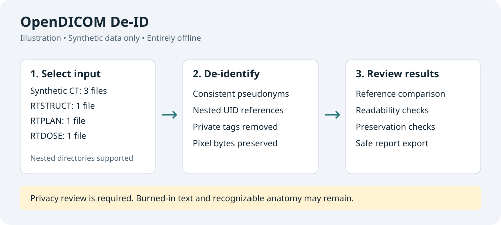

# OpenDICOM De-ID

Simple, offline, cross-platform DICOM de-identification.

OpenDICOM De-ID is a Python desktop application for de-identifying batches of
DICOM files while preserving relationships between images and radiotherapy
objects. It works locally, with no account, telemetry, PACS connection, or data
upload. The processing engine also has a command-line interface.

**Version 0.1.0 is an initial validation release.** Automated checks do not prove
that all identifying information has been removed, establish clinical
suitability, or demonstrate regulatory compliance. Review every dataset before
sharing it. No claim of a fully verified DICOM confidentiality profile is made.

## What it does

- Recursively discovers DICOM files and shows counts by modality.
- Builds one UID mapping for the complete batch, including arbitrarily nested
  references, while retaining technical UIDs such as SOP Class and Transfer Syntax.
- Assigns different patient pseudonyms within a batch and uses each patient's
  pseudonym consistently across studies.
- Removes private metadata by default; offers date removal or consistent date
  shifting and neutral output grouping for separate dose runs.
- Compares input/output references, pixel bytes, geometry, and selected RT
  parameters. Pre-existing external references produce explicit findings.
- Rejects conflicting instance duplicates and unsafe input/output locations.
- Publishes output only after mandatory checks; cancellation or failure does not
  present partial output as a completed dataset.
- Saves reports without original patient values, source paths, or UID mappings.

The application uses pydicom and selected rules from Kitware's
[dicom-anonymizer](https://github.com/KitwareMedical/dicom-anonymizer), with its own
UID traversal and validation. See [the implemented policy and limitations](docs/confidentiality.md)
and [architecture](docs/architecture.md). [Validation evidence](docs/validation.md)
describes the synthetic regression and the remaining acceptance work.

## Desktop workflow



The illustration uses synthetic counts; it is not a clinical validation result.

1. Choose the input directory. A preliminary scan counts DICOM files and modalities.
2. Choose a **new or empty** output directory, outside the input directory tree.
3. Leave the defaults in place, or expand **Advanced options**.
4. Click **De-identify**. You can cancel while the interface remains responsive.
5. Read the findings, save a report if needed, and perform a privacy review.

Private-tag removal and validation are always enabled. A custom prefix must be a
neutral label; do not use a patient name or original identifier. Source grouping
uses labels such as `group-0001` and never copies original directory names.

Reports use a new `.json` filename and never overwrite an existing file. Saving
inside the selected input tree is prohibited. Pseudonym and UID mappings exist
only in memory; this version offers no reversible identity export.

## Install a desktop build

Download a prebuilt application from
[Native desktop builds](https://github.com/JMartinon/opendicom-deid/actions/workflows/build.yml).
Open a successful run, then choose your platform under **Artifacts**. These
packages include Python, Tcl/Tk, the application, and dependency notices.
**End users do not need Python, a terminal, or a local build.**

For Windows, select **OpenDICOM-De-ID-Windows-x86_64**. Extract the downloaded
GitHub artifact ZIP, then extract the application ZIP inside it. Double-click
`OpenDICOM-De-ID.exe` in the extracted folder. The standalone executable includes
its runtime; keep the accompanying license notices when distributing it.

The repository is private, so GitHub downloads require signing in with an
account that has repository access. Actions artifacts are retained for **14
days**. For a published version, use the platform archive under **Assets** on the
[Releases page](https://github.com/JMartinon/opendicom-deid/releases); release
assets are not subject to Actions artifact expiry. A maintainer must publish a
release before it is available there to other repository readers.

| Platform | Distribution | Opening it |
| --- | --- | --- |
| Windows x86-64 | ZIP with standalone `.exe` | Extract, then double-click the executable |
| macOS Apple Silicon | ZIP with `.app` | Extract, then open the app |
| macOS Intel | Separate ZIP with `.app` | Extract the Intel build, then open the app |
| Ubuntu x86-64 | Portable `.tar.gz` folder | Extract the entire folder, then open its executable |

Packages are **not publisher-signed or notarized**. Windows and macOS can warn
about an unknown developer. The Ubuntu CI package targets Ubuntu 24.04 or newer;
glibc and desktop libraries are not completely bundled. See
[distribution instructions](docs/distribution.md) for platform requirements,
security prompts, manual validation, and build limitations.

The repository starts **private**. A CI configuration is not evidence that a
platform build has passed. Review the actual workflow results and test each
downloaded artifact on a clean target machine before publishing a release.

## Develop locally

Use Python 3.12 or newer, with Tcl/Tk for the GUI. The CLI and tests can run
without Tcl/Tk. Official Python installers for Windows and macOS include Tk;
Linux distributions may require their `python3-tk` package. That package serves
the distribution's system Python, and does not add Tk to an unrelated custom
Python installation. See [Linux build setup](docs/distribution.md#linux-build-setup).

```sh
python3 -m venv .venv
# macOS / Linux
source .venv/bin/activate
# Windows PowerShell: .venv\Scripts\Activate.ps1
python -m pip install -e '.[dev,build]'
python -m pytest
python -m ruff check .
python -m opendicom_deid
```

Only synthetic datasets are generated by the tests. Do not place real patient
data, identifying logs, mappings, or credentials in this repository.

The command-line interface exposes the same engine:

```sh
opendicom-deid scan /path/to/input
opendicom-deid deidentify /path/to/input /path/to/output --report /path/to/report.json
opendicom-deid deidentify /path/to/input /path/to/output --dates shift --organization source
opendicom-deid validate /path/to/deidentified --report /path/to/validation.json
```

Exit codes: `0` for technical success (warnings may remain), `1` for failure,
`2` for invalid arguments/settings, and `130` for cooperative cancellation.
The independent `validate` command can inspect an output directory without the
original dataset, but it cannot establish original/output equivalence without
the in-memory batch comparison. Privacy review remains required in every case.

## Build native packages

Run on the target operating system. On Ubuntu 24.04 or newer, install the system
Python GUI support once, then build with that interpreter:

```sh
sudo apt-get update
sudo apt-get install python3-tk python3-venv libpython3-dev
PYTHON=/usr/bin/python3 bash scripts/build_linux.sh
```

The Linux wrapper checks Python/Tk before installing dependencies or running
tests. By default it tries `python3`, then `/usr/bin/python3` if needed. An
explicit `PYTHON` selection is used strictly. It reuses a compatible selected
virtual environment, or creates an isolated `.venv-build-linux` environment.
See [distribution instructions](docs/distribution.md#linux-build-setup) for
custom Python installations and headless build hosts.

For macOS and Windows, use an activated virtual environment with Tcl/Tk:

```sh
# macOS
bash scripts/build_macos.sh
```

```powershell
# Windows x86-64
.\scripts\build_windows.ps1
```

The scripts install build dependencies, run tests, collect license notices, and
create a package and SHA-256 checksum in `dist/release/`. Build-time dependency
installation uses the network; the application itself performs no network
operations. Dependencies are pinned for DICOM behavior in `pyproject.toml`.

The **Tests** workflow checks Python 3.12 and 3.14 on native operating systems.
**Native desktop builds** can be run manually. Pushing a matching version tag,
for example `v0.1.0`, runs native builds and creates a **draft prerelease**. The
draft allows artifact testing before a maintainer deliberately publishes it.
No workflow changes repository visibility.

## Create the private GitHub repository

If the working directory has not yet been initialized or pushed, run:

```sh
git init -b main
git add .
git diff --cached --stat
git commit -m "Initial OpenDICOM De-ID implementation"
gh auth login
gh repo create opendicom-deid --private --source=. --remote=origin \
  --description 'Simple, offline, cross-platform DICOM de-identification.' --push
gh repo view --json nameWithOwner,visibility,url
```

Inspect the staged files before committing. Keep the repository private until
the application and distribution artifacts have been reviewed and validated.

## Limitations and privacy

- No pixel redaction, OCR, facial de-identification, or clinical transformation
  is performed. Burned-in text and recognizable anatomy can remain.
- Free text and unusual vendor-specific content need manual inspection. Private
  metadata removal can affect downstream vendor workflows.
- Unsupported object classes are reported; file readability alone does not
  establish safe de-identification or application compatibility.
- Batch consistency is not cross-run linkage. Separate runs deliberately create
  new identities and UIDs.
- Date shifting preserves intervals and may preserve identifying patterns.
- Original files must remain stable during processing. Large datasets can take
  time, and cancellation waits for a safe checkpoint.
- Synthetic regression tests reproduce nested RT reference failures. Real
  ViewRay, SlicerRT, and clinical-system acceptance tests still need to be run by
  authorized users on their own systems; no patient dataset is included.

## License

OpenDICOM De-ID is licensed under [BSD-3-Clause](LICENSE). Kitware
dicom-anonymizer uses BSD-3-Clause, and pydicom uses MIT. Dependency notices are
retained in [THIRD_PARTY_LICENSES](THIRD_PARTY_LICENSES) and collected from the
exact installed versions during packaging. **About** displays bundled notices.
